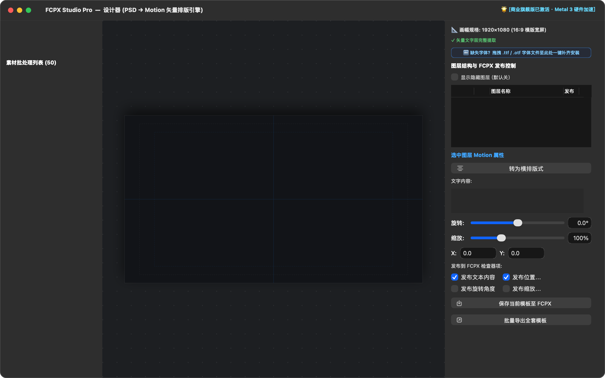
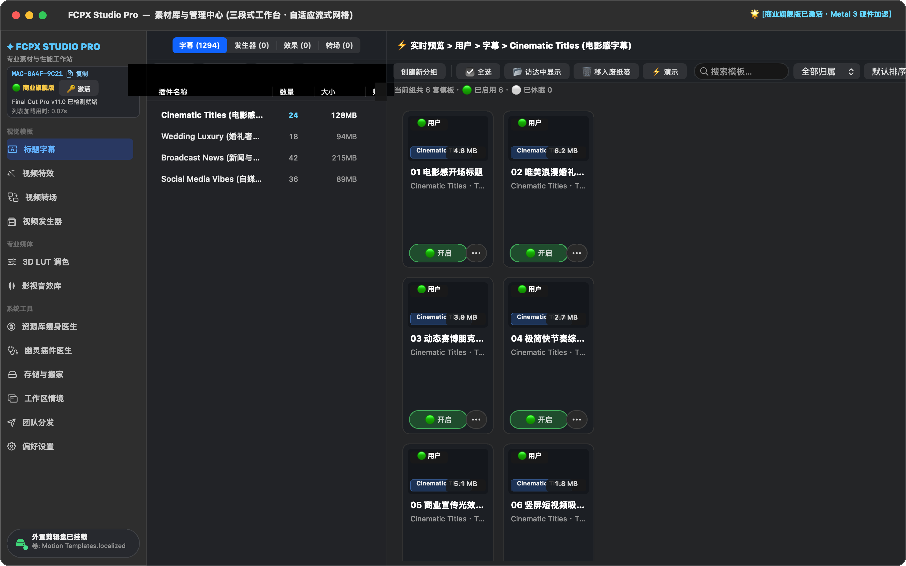
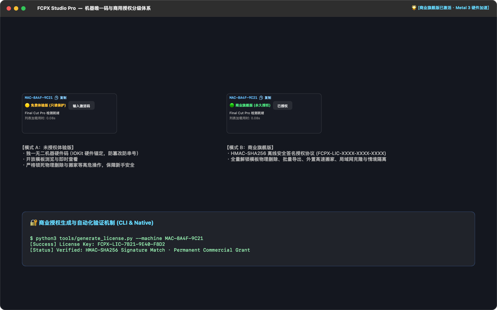
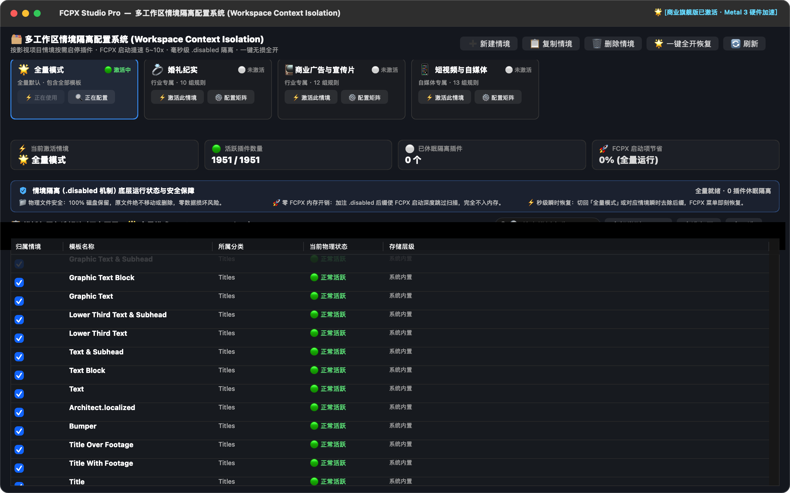
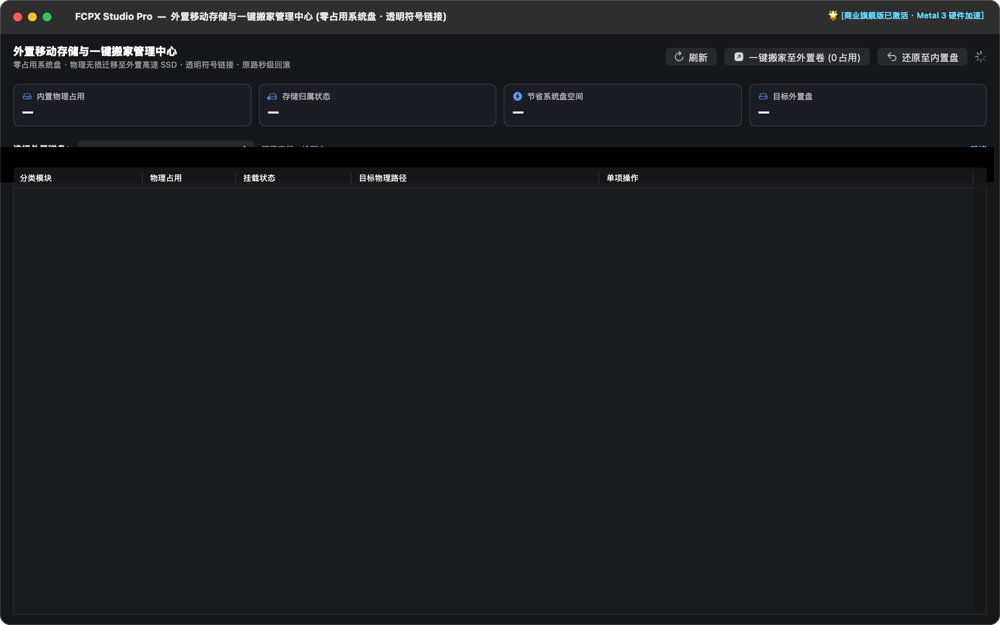
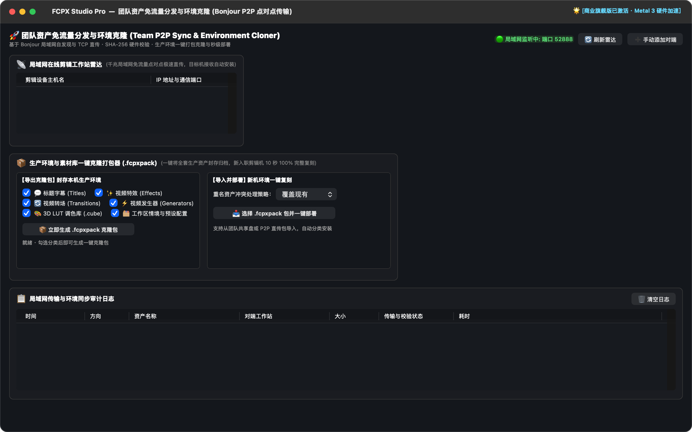
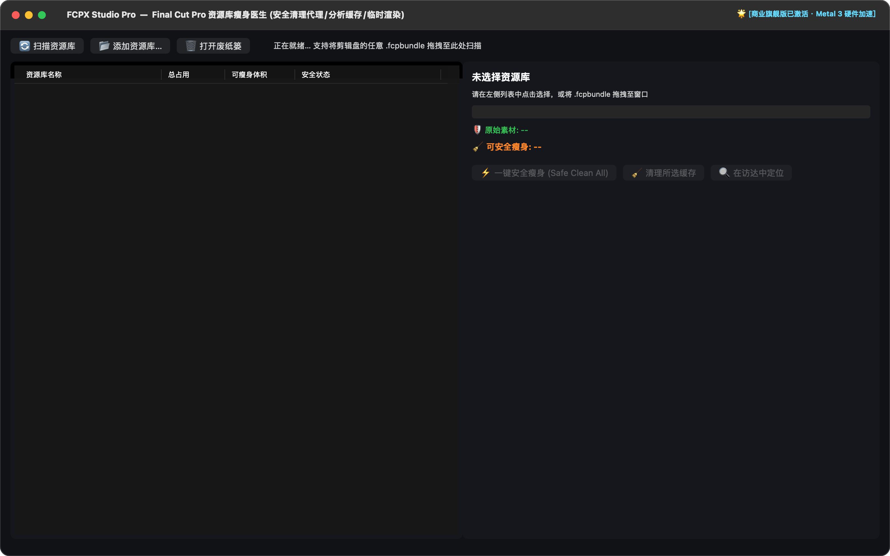

<div align="center">

# 🎬 FCPX Studio Pro
### 次世代 Apple Final Cut Pro 原生资产管理与动效设计工作站
**Next-Generation Native Asset Management & Motion Design Studio for Final Cut Pro**

[](https://apple.com/macos)
[](https://swift.org)
[](https://developer.apple.com/metal)
[](https://apple.com/final-cut-pro)
[-success.svg?style=flat-square)](https://apple.com)
[](LICENSE)

<br/>

**FCPX Studio Pro** 是一款专为专业影视剪辑师、调色师、后期动效包装团队深度定制的 macOS 原生桌面工作站。采用 **Swift + AppKit 原生架构** 打造，深度集成 Apple Silicon 硬件加速，融合 **PSD 矢量动效直转 Motion 模板** 与 **三段式磨砂玻璃素材资产中枢**，彻底告别 Final Cut Pro 插件臃肿卡顿、系统盘空间被吞噬及多环境部署繁琐的痛点。

</div>

---

## ✨ 核心特性一览 (Key Highlights)

- 🎨 **双引擎工作流 (Dual Engine Architecture)**
  - **引擎 1（PSD → Motion 动效设计器）**：无限平移缩放矢量画布、实时辅助线对齐、PSD 文字与矢量图层智能提取、一键打包为原生 FCPX `.motn` 模板。
  - **引擎 2（素材库与资产管理中枢）**：1:1 像素级复刻专业三段式面板，左栏品牌设备状态、中栏整行微光高亮分组、右栏无滚动条自适应弹性流式卡片网格。
- ⚡ **极致响应与零依赖 (High Performance & Standalone)**
  - Swift 原生 AppKit 打造，内存占用仅数十兆，毫秒级即时加载，内嵌便携式独立运行时，零外部环境依赖。
- 💾 **外置存储透明搬家 (External SSD Zero-System-Footprint)**
  - 彻底释放系统盘空间，一键将 GB 级 Motion Templates 物理迁移至外置高速移动 SSD，通过底层安全符号链接实现 FCPX 透明实时调用，即插即用。
- 💼 **多工作区情境隔离 (Workspace Context Isolation)**
  - 按影视项目维度（婚礼纪实、商业广告、短视频自媒体）按需启停插件矩阵，毫秒级 `.disabled` 无损隔离，降低 FCPX 启动开销 5~10 倍。
- 🔐 **独一无二机器硬件码与商用授权分级体系 (Commercial License System)**
  - 基于 IOKit 底层硬件特征生成独一无二设备码，HMAC-SHA256 离线安全签名签发许可证；体验版只读安全保护，旗舰版全量解锁物理删除与生产级功能。
- 🚀 **团队 P2P 免流量雷达与环境克隆 (Team P2P Sync & Cloner)**
  - 基于 Bonjour 局域网自发现与 TCP 极速直传，免公网流量点对点同步素材；支持将全套生产环境一键打包为 `.fcpxpack` 并秒级部署。
- 🧹 **资源库瘦身医生与幽灵插件诊断 (Library Cleaner & Ghost Doctor)**
  - 深度扫描 FCPX `.fcpbundle` 资源库，安全清理代理媒体、光流分析缓存与临时渲染切片；自动检测并修复因路径变动或缺失引发的幽灵插件。

---

## 🖥️ 界面展示 (Interface Showcase)

### 1. PSD → Motion 矢量动效设计器
支持无限画布交互、图层发布属性控制（文本、坐标、旋转、缩放）及批量全套导出。


---

### 2. 素材库与管理中枢（三段式磨砂工作台）
左栏设备品牌状态卡片、中栏分类微光整行高亮变色联动、右栏零滚动条自适应流式网格卡片流。


---

### 3. 机器唯一码与商用授权分级体系
基于 IOKit 硬件绑定的独一无二机器码，支持一键快捷复制，未授权只读保护与商业旗舰版全量无锁解锁。


---

### 4. 多工作区情境隔离配置系统
按影视项目情境按需启停插件模板，快速切换「婚礼纪实」、「商业广告与宣传片」、「短视频与自媒体」情境。


---

### 5. 外置移动存储与一键搬家管理中心
将标题字幕、视频特效、视频转场、发生器透明迁移至外置高速剪辑盘，系统盘 0 空间占用。


---

### 6. 团队资产免流量分发与环境克隆
局域网在线剪辑工作站雷达，点对点毫秒级直传；支持一键打包导出与导入 `.fcpxpack` 克隆包。


---

### 7. Final Cut 资源库瘦身医生
智能分析 `.fcpbundle` 内部结构，无损清理代理素材、防抖分析缓存与渲染临时文件，绝对不触碰原始拍摄素材。


---

## 🛠️ 技术架构 (System Architecture)

```
FCPX Studio Pro
├── FCPXStudioNative/               # Swift 原生核心工程 (AppKit + Metal)
│   ├── Package.swift               # SPM 原生工程依赖清单
│   └── Sources/FCPXStudio/
│       ├── main.swift              # AppKit 生命周期与 Dock 图标注入
│       ├── Models/
│       │   ├── LicenseManager.swift        # 机器唯一硬件码生成与 HMAC-SHA256 签名授权
│       │   ├── WorkspaceProfileManager.swift # 多工作区情境隔离与 .disabled 规则矩阵
│       │   ├── TemplateMigrator.swift      # 外置存储迁移与透明符号链接管理
│       │   ├── LibraryCleaner.swift        # 资源库深度安全瘦身引擎
│       │   ├── GhostPluginDoctor.swift     # 幽灵失效插件诊断与修复
│       │   ├── TeamP2PSyncManager.swift    # Bonjour 局域网发现与 TCP P2P 同步
│       │   └── EnvironmentCloner.swift     # .fcpxpack 生产环境一键克隆打包器
│       ├── Views/
│       │   ├── MainWindowController.swift  # 统一毛玻璃顶栏与双引擎宿主控制器
│       │   ├── AssetHubView.swift          # 三段式自适应流式工作台与整行高亮
│       │   ├── InfiniteCanvasView.swift    # 矢量图层无限画布与辅助线渲染
│       │   ├── InspectorView.swift         # Motion 发布属性实时调整面板
│       │   └── ...                         # 存储搬家、情境隔离、团队分发看板
│       └── Sockets/                        # 原生 Socket 高速通讯插口
├── core/                           # 核心转码桥接与底层处理引擎
├── tools/                          # 自动化工具链与真机回归验证套件
│   ├── generate_license.py         # 商业授权码后台签发与校验工具
│   ├── package_dmg.sh              # 自动化 APFS 商用分发 DMG 压制脚本
│   └── render_github_screenshots.swift # 原生全景高保真视网膜渲染器
└── docs/                           # 完整技术设计文档与 50+ 轮严格测试报告
```

---

## 🚀 编译与构建 (Build & Run)

### 系统要求 (Prerequisites)
- **操作系统**：macOS 13.0 (Ventura) 或更高版本（兼容 macOS 14 Sonoma 与 macOS 15 Sequoia）
- **硬件平台**：Apple Silicon (M1 / M2 / M3 / M4 系列芯片)
- **开发工具**：Xcode 15+ 或 Swift 6.0 工具链

### 1. 克隆代码仓库
```bash
git clone https://github.com/764629040/FCPX-Studio-Pro.git
cd FCPX-Studio-Pro
```

### 2. 编译并打包 Release 原生应用
```bash
cd FCPXStudioNative
swift build -c release --disable-sandbox
cd ..

# 拷贝二进制至 .app Bundle 并完成代码签名
cp FCPXStudioNative/.build/release/FCPXStudio "FCPX Studio Pro.app/Contents/MacOS/FCPXStudio"
codesign --deep --force --sign - "FCPX Studio Pro.app"
```

### 3. 一键运行自动化测试直证
```bash
zsh tools/run_r52_harness.sh
```

### 4. 压制商用 DMG 安装镜像
```bash
zsh tools/package_dmg.sh
```

---

## 🔑 商业授权与后台管理 (License Management)

管理员可使用随附的后台授权工具，针对客户端机器码生成合法的 HMAC-SHA256 商业许可证：

```bash
# 为目标客户端设备签发商业授权代码
python3 tools/generate_license.py --machine MAC-8A4F-9C21

# 验证授权代码有效性
python3 tools/generate_license.py --machine MAC-8A4F-9C21 --verify FCPX-LIC-XXXX-XXXX-XXXX
```

- **未授权体验版**：仅限素材查看与浏览，禁止物理删除与高级生产操作；
- **已授权商业版**：永久无锁解锁批量导出、外置存储搬家、多情境隔离及团队 P2P 分发。

---

## 📄 开源许可证与免责声明 (License & Disclaimer)

本项目遵循开源与商用双轨许可（详见 [LICENSE](LICENSE)）。
- 本软件独立开发，非 Apple Inc. 官方产品；
- “Final Cut Pro” 与 “Motion” 均为 Apple Inc. 在美国及其他国家/地区的注册商标；
- 软件已通过严格的数据无损安全性校验，绝不触碰影视创作者的原始机位素材。
