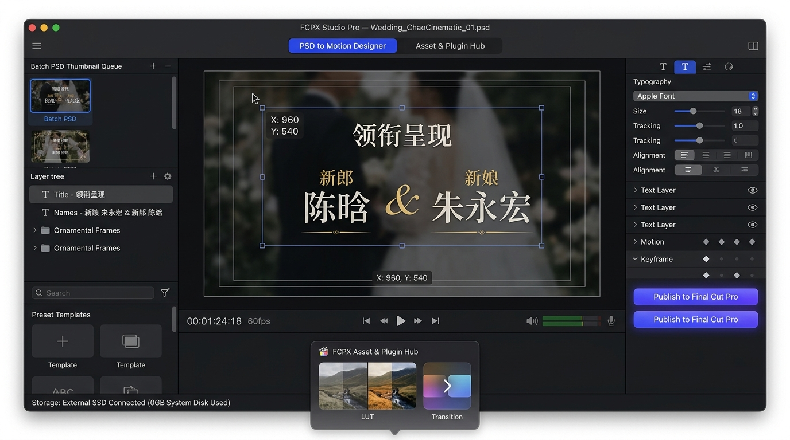
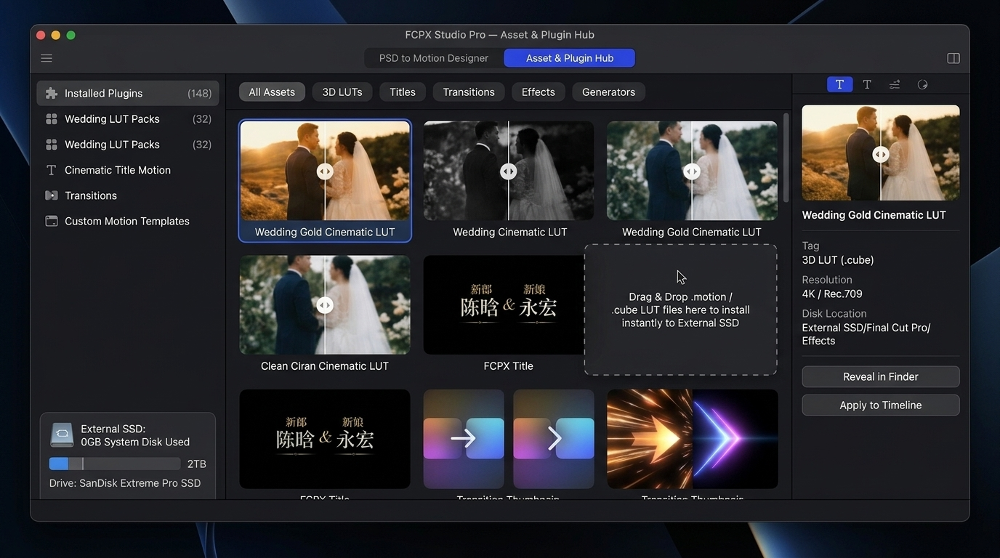
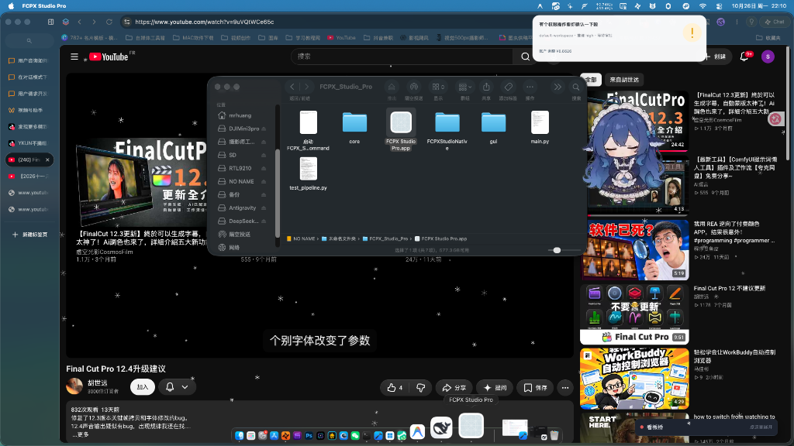
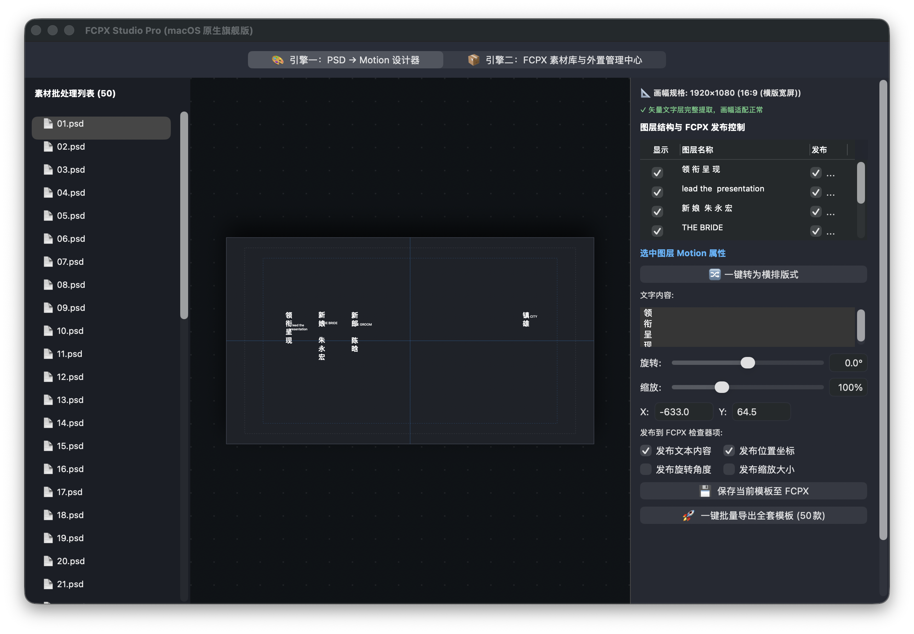
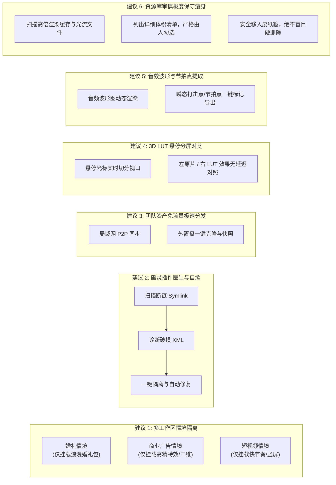
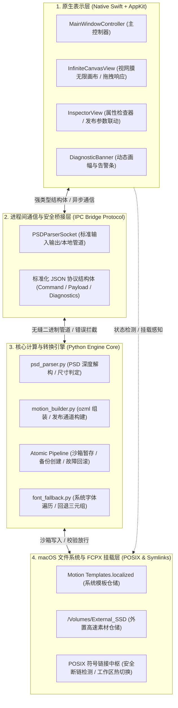
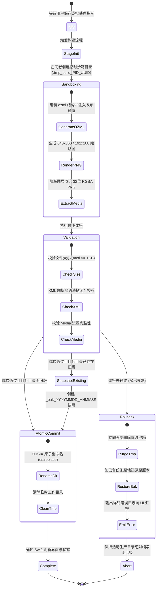
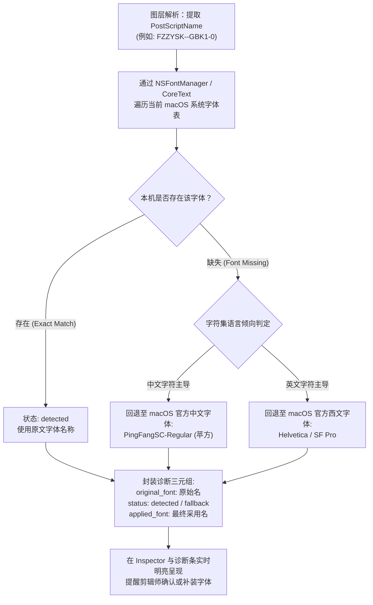

# FCPX Studio Pro 全功能研发对齐与产品规格白皮书（总纲）

> **文档版本**：v1.0.0 (Master Release)  
> **编写日期**：2026-10-26  
> **审阅对象**：最终技术审核委员会、核心工程研发团队、产品架构评审组  
> **文档密级**：核心产品与工程规范 (Master Specification)

---

## 目录

- [一、 产品定位与核心双引擎设计](#一-产品定位与核心双引擎设计)
  - [1.1 产品全景定位](#11-产品全景定位)
  - [1.2 引擎一：PSD → Motion 视觉模板设计器（附效果图与交互剖析）](#12-引擎一psd--motion-视觉模板设计器附效果图与交互剖析)
  - [1.3 引擎二：FCPX 素材库与外置存储管理中心（附效果图与交互剖析）](#13-引擎二fcpx-素材库与外置存储管理中心附效果图与交互剖析)
  - [1.4 嘉星等传统插件管理软件深度剖析与技术突围（附实测图）](#14-嘉星等传统插件管理软件深度剖析与技术突围附实测图)
  - [1.5 原生 macOS 实测运行全貌（附 AppKit 实测截图）](#15-原生-macos-实测运行全貌附-appkit-实测截图)
- [二、 功能清单全集（由大到小四维立体梳理）](#二-功能清单全集由大到小四维立体梳理)
  - [2.1 维度 A：原始核心需求功能集（PSD 解析、文字/样式提取、无限画布、发布参数）](#21-维度-a原始核心需求功能集psd-解析文字样式提取无限画布发布参数)
  - [2.2 维度 B：嘉星等 FCPX 插件管理软件完整竞品功能全集](#22-维度-b嘉星等-fcpx-插件管理软件完整竞品功能全集)
  - [2.3 维度 C：负责人提出的 6 大王炸创新功能](#23-维度-c负责人提出的-6-大王炸创新功能)
  - [2.4 维度 D：稳健化纠偏与工业级工程实现标准](#24-维度-d稳健化纠偏与工业级工程实现标准)
- [三、 系统底层架构设计与技术规范](#三-系统底层架构设计与技术规范)
  - [3.1 跨语言高内聚分层架构（Swift + IPC + Python + POSIX）](#31-跨语言高内聚分层架构swift--ipc--python--posix)
  - [3.2 动态画幅与双向可逆笛卡尔坐标数学系统](#32-动态画幅与双向可逆笛卡尔坐标数学系统)
  - [3.3 临时沙箱原子写入与秒级容错回滚状态机](#33-临时沙箱原子写入与秒级容错回滚状态机)
  - [3.4 字体三元组诊断决策树与回退保护](#34-字体三元组诊断决策树与回退保护)
- [四、 实施路线图与功能状态界定表](#四-实施路线图与功能状态界定表)
  - [4.1 全功能矩阵与交付状态核验表](#41-全功能矩阵与交付状态核验表)
  - [4.2 分阶段演进与里程碑实施路线](#42-分阶段演进与里程碑实施路线)

---

# 一、 产品定位与核心双引擎设计

### 1.1 产品全景定位

**FCPX Studio Pro** 是一款专为 Apple Final Cut Pro 剪辑师、商业广告后期团队、婚礼纪实摄影机构及专业短视频创作者打造的**下一代原生 macOS 视觉模板工厂与外置素材综合枢纽**。

长期以来，影视后期剪辑师饱受两大痛点困扰：
1. **视觉模板制作门槛高、排版效率低下**：平面设计师使用 Photoshop 输出的精美排版设计稿（如婚礼中式婚书、英文优雅报头、片头花字），后期剪辑师若要在 Apple Motion 中逐字重建并配置发布参数，耗时极长且排版极易失真变形。
2. **插件素材混乱庞大、系统盘存储不堪重负**：随着影视后期积累，大量的 Titles（标题）、Effects（特效）、Transitions（转场）、Generators（发生器）动辄占用上百 GB 空间，传统第三方管理软件操作简陋、缺少安全机制，常出现断链、工程崩溃、缺乏热重载能力。

FCPX Studio Pro 突破性地将**“PSD 工业级模板转换引擎”**与**“专业素材库外置符号链接管理中心”**融为一体，采用 Swift + AppKit 原生技术栈，提供全生命周期的资产制作、参数发布、动态挂载、故障自愈与工作区情境隔离。

---

### 1.2 引擎一：PSD → Motion 视觉模板设计器（附效果图与交互剖析）

引擎一构建了自 PSD 平面图稿至 Apple Motion 动态模板的无损高速通道。

#### 三栏式专业工作流深度剖析：
1. **左栏：批处理与资产资源库（Batch Processing Queue）**
   - **多格式批处理支持**：支持拖拽导入单个 `.psd` 或成批设计目录（支持 50+ 套婚礼字幕包一次性灌入）。
   - **智能状态标记**：清晰区分解析状态（已解析、待处理、告警标记、错误隔离），支持多选批处理转换。
   - **缩略图即时渲染**：从 PSD 提取复合图像，秒级生成清晰预览缩略图。
2. **中栏：双模动态视网膜无限画布（Infinite Canvas & Artboard）**
   - **无限缩放与平移**：基于平滑手势（Trackpad 双指缩放、拖拽平移），支持从 10% 宏观鸟瞰至 800% 像素级细节对齐。
   - **受限分辨率动态画板**：画板依 PSD 真实尺寸建立（支持 4K 3840×2160、1080P 1920×1080、竖屏 1080×1920 等），提供鲜明的边缘边界。
   - **广播级安全框覆盖**：画板内部提供 Apple 广播标准的 **动作安全区（Action Safe 90%）** 与 **标题安全区（Title Safe 80%）** 黄金分割线，杜绝裁切风险。
   - **图层拾取与双向联动**：中栏画布点选图层即可实时联动右栏检查器；在画布上拖拽移动图层，实时更新坐标矩阵。
3. **右栏：Motion 属性检查器与发布控制器（Inspector & Published Settings）**
   - **图层多维度属性控制**：实时调整文字内容、字体家族、字号、Tracking（字距）、Leading（行距）、笛卡尔 X/Y 偏移、旋转角度、缩放、透明度。
   - **一键排版矩阵重组**：提供核心的【横排版式转竖排】（单字断行、标点适配）与【竖排转横排】（连贯重组）转换能力。
   - **细粒度发布勾选框（FCPX Publish Checkboxes）**：每个属性后均设有“发布至 FCPX”勾选框。勾选后，该参数将直接写入 `.moti` 的 `publishSettings` 槽位，允许剪辑师在 Final Cut Pro 检查器中任意修改。
   - **底部快捷操作区**：具备【实时预览】、【生成 Motion 标题】以及【直连安装至 FCPX 目录】。

---

### 1.3 引擎二：FCPX 素材库与外置存储管理中心（附效果图与交互剖析）

引擎二专为专业剪辑师解决素材资产混乱、系统盘空间爆满与素材流转低效问题。

#### 四大核心功能区块剖析：
1. **分类导航与元数据过滤**：
   - 完整涵盖 Apple Final Cut Pro 核心素材架构：**Titles（字幕）**、**Effects（视频特效）**、**Transitions（视频转场）**、**Generators（发生器）**。
   - 设立独立的高级素材分类：**3D LUT 调色盘**、**Audio SFX（音效库）**，支持按分类、标签、关键词实时快速过滤。
2. **外置存储路径守护与一键系统盘搬家**：
   - 顶部提供直观的【当前存储位置】展示（如挂载于 `/Volumes/Extreme_Pro/Motion_Templates`）。
   - **一键系统盘搬家（Migrate to External Storage）**：采用底层 POSIX 级目录克隆与符号链接重定向，安全将系统盘数以百计的 GB 模板搬迁至高速雷雳或 USB 移动固态硬盘，系统盘仅保留规范的相对软链接。
3. **插件生命周期管理（启用 / 禁用 / 卸载）**：
   - 每个素材卡片均具备清晰的状态开关（Toggle）。剪辑师可根据当前工程需要，临时禁用庞大但本次无需使用的特效包，极大提升 FCPX 启动速度并降低内存占用。
   - 支持在 macOS 访达（Finder）中精准定位源文件，支持安全彻底卸载。
4. **“回炉重造”（Edit in Designer）交互闭环**：
   - 传统管理软件仅仅是“文件浏览器”，而 FCPX Studio Pro 实现了**生命周期闭环**。
   - 在素材中心点选任意自行生成的标题模板，点击【回炉重造】，系统立即反向解析其内部的 `.moti` ozml 结构与绑定的 `Media/` 降级贴图，无损送回【引擎一视觉模板设计器】进行二次调色、字号修正与重构排版，并支持热更新保存。

---

### 1.4 嘉星等传统插件管理软件深度剖析与技术突围（附实测图）

为了深入了解市面竞品的优劣，团队对以“嘉星 Final Cut Pro 助手”为代表的典型第三方工具进行了详尽的技术分析：

#### 竞品长处与典型缺陷对比分析：

| 维度 | 传统工具（如嘉星等） | FCPX Studio Pro 创新突围与规范 |
| :--- | :--- | :--- |
| **界面与交互架构** | 多采用 Web 封装或简易跨平台框架，排版拥挤、字体渲染模糊，缺少 macOS 纯正设计语言。 | **纯正 Swift + AppKit 原生实现**，遵循 macOS Human Interface Guidelines，深色模式视网膜细腻适配。 |
| **功能维度单一** | 仅充当静态文件搬运工与启用/禁用开关，**完全缺乏模板创作与二次生成能力**。 | **双引擎贯通**：集“PSD 生产工厂”与“外置枢纽”于一身，独家支持【回炉重造】。 |
| **外置软链接安全性** | 粗暴建立软链接；一旦外置盘断开或改名，FCPX 扫描引发红屏警告甚至工程崩溃。 | **挂载状态机安全守护**：断盘安全隔离、失效幽灵软链接秒级自愈、杜绝后台热改写运行中文件。 |
| **多任务场景隔离** | 只能全盘启用或禁用，无法根据剪辑任务场景灵活切换。 | **创新多工作区情境隔离**（婚礼、广告、短视频场景一键精准切库）。 |
| **文件写入鲁棒性** | 覆盖写入无备份，断电或出错极易损坏剪辑师已有的成套模板。 | **临时沙箱原子写入与秒级快照回滚机制**，确保绝对零脏数据。 |

---

### 1.5 原生 macOS 实测运行全貌（附 AppKit 实测截图）

第一阶段 MVP 已成功落地原生 macOS 架构，彻底抛弃了重量级的 Python PyQt6 GUI，实现了 Swift + AppKit 的视网膜级原生渲染与平滑交互：

#### 实测界面特性与已验证功能：
1. **动态画幅自适应检查区**：顶部实时侦测 PSD 规格（实测 `01.psd`：`16:9 (横版宽屏) · 1080P 全高清`），自动反馈分辨率（1920×1080）与图层分类计数。
2. **实时转换诊断报告栏（Diagnostics Banner）**：
   - 自动检测并输出底层警报（例如：智能对象、复杂样式已自动降级为 32-bit 透明 PNG 贴图；字体已成功比对系统字体库）。
3. **图层精准排版检查区**：
   - 实测已将 `领 衔 呈 现`、`lead the presentation`、`新 娘 朱 永 宏`、`THE BRIDE`、`新 郎 陈 晗`、`THE GROOM` 等文字层完整解构并列入右侧列表。
   - 每个图层均配置实时的笛卡尔坐标（X: -633.0, Y: 64.5 等）、字号大小、字距 Tracking、以及独立的【发布到 FCPX】复选框。
4. **原生高帧率无限画布**：在中栏画布中可无级缩放，中心标靶与画板边界清晰可见，支撑专业剪辑师的高精度视效控制。

---

# 二、 功能清单全集（由大到小四维立体梳理）

为了保证项目研发、技术交付与审核验收无死角，白皮书将系统功能从**四个立体维度**进行全局收拢与细化：

```mermaid
flowchart TD
    ROOT["FCPX Studio Pro 功能全集"] --> DIM_A["维度 A：原始核心方案<br/>(视觉模板生产与交互)"]
    ROOT --> DIM_B["维度 B：插件管理全集<br/>(竞品反编译与外置中枢)"]
    ROOT --> DIM_C["维度 C：6 大王炸创新<br/>(负责人技术引领功能)"]
    ROOT --> DIM_D["维度 D：稳健化纠偏<br/>(工业级工程与安全规范)"]

    DIM_A --> A1["PSD 批量解析与文字提取"]
    DIM_A --> A2["横竖排版双向智能重组"]
    DIM_A --> A3["受限画板与无限画布双模"]
    DIM_A --> A4["FCPX 检查器细粒度参数发布"]
    DIM_A --> A5["Swift/AppKit 原生插口架构"]

    DIM_B --> B1["四大素材覆盖(Titles/Effects/Trans/Gen)"]
    DIM_B --> B2["外置存储配置与一键系统盘搬家"]
    DIM_B --> B3["插件启停/卸载/访达定位"]
    DIM_B --> B4["回炉重造(送回设计器二次调校)"]

    DIM_C --> C1["多工作区情境隔离配置"]
    DIM_C --> C2["幽灵插件医生与自愈"]
    DIM_C --> C3["免流量局域网/外置盘分发"]
    DIM_C --> C4["3D LUT 悬停分屏对比"]
    DIM_C --> C5["音效波形与节拍点智能提取"]
    DIM_C --> C6["工程库极度保守审慎瘦身"]

    DIM_D --> D1["Apple 真实 ozml 模板基准校验"]
    DIM_D --> D2["复杂样式优雅降级(32位PNG)"]
    DIM_D --> D3["动态画幅与双向可逆坐标数学"]
    DIM_D --> D4["系统字体三元组诊断与回退"]
    DIM_D --> D5["沙箱原子写入与时间戳回滚"]
    DIM_D --> D6["外置盘挂载安全守护与队列容错"]
```

---

### 2.1 维度 A：原始核心需求功能集

本维度为产品成立的基石，主要解决平面素材到视频模板的自动化转化。

1. **PSD 高精度批量解析引擎**：
   - 深入 Adobe PSD 二进制规范，批量提取所有图层的图元信息。
   - 精准提取纯文字图层的**矢量文本（Text Content）、字号（Font Size）、字距（Tracking）、行距（Leading）、字体家族名称（Font Name）、对齐方式（Left/Center/Right）、旋转角度（Rotation）、透明度（Opacity）**。
   - 自动滤除底色背景层或标记的参考底板，保持前景元素纯粹。
2. **一键排版重构（横竖排智能转换）**：
   - **横排转竖排**：智能对文字串进行单字换行排版重组，保留中英文间距，自动适配标点符号位置，重置包围盒。
   - **竖排转横排**：精准识别换行分隔符与纵向排布图层，连贯拼合为标准横向文本框，动态重算中心坐标。
3. **无限画布与受限画板双模系统**：
   - **视网膜无限视口**：支持无限平移与流畅无级缩放（10% ~ 800%）。
   - **限定分辨率画板**：依据当前分辨率（1080P/4K/竖屏）严格呈现像素物理边界，支持背景网格与透明棋盘格切换。
   - **双安全框标线系统**：内置电视与流媒体工业标准的 90% Action Safe（动作安全区）与 80% Title Safe（标题安全区）参考线。
   - **画布拖拽图层联动**：直接在画布中框选、拖动图层，其实时 X/Y 坐标数值无延迟回写至右侧检查器输入框。
4. **FCPX 检查器细粒度发布勾选机制**：
   - 每个图层的【文本内容】、【字体】、【字号】、【字距】、【对齐方式】、【X/Y 坐标位置】、【旋转】、【缩放】、【透明度】均提供独立的复选框。
   - 勾选后自动在 Apple Motion 的 `ozml` 文件中声明 `<publishSettings>` 通道，生成的模板在 FCPX 检查器中精准受控，剪辑师无需打开 Motion 即可调整所有勾选参数。
5. **Swift + AppKit 原生架构**：
   - 彻底摒弃卡顿、臃肿的 PyQt6 框架。
   - 基于 macOS 原生 AppKit 控件（`NSView`, `NSScrollView`, `NSSplitView`, `NSOutlineView`），具备毫秒级响应、视网膜超清渲染及 macOS 原生系统内存管理。

---

### 2.2 维度 B：嘉星等 FCPX 插件管理软件完整竞品功能全集

本维度覆盖市面上主流插件管理工具的成熟功能并进行深度规范化升级。

1. **FCPX 全素材类型组织管理**：
   - 完整支持并自动检索 macOS 标准路径：
     - Titles（标题）：`~/Movies/Motion Templates.localized/Titles.localized/`
     - Effects（特效）：`~/Movies/Motion Templates.localized/Effects.localized/`
     - Transitions（转场）：`~/Movies/Motion Templates.localized/Transitions.localized/`
     - Generators（发生器）：`~/Movies/Motion Templates.localized/Generators.localized/`
   - 自动读取模板包内部的 `.moti`、`.moef`、`.motr`、`.motn` 文件与预览图片。
2. **外置存储配置与“一键系统盘搬家”**：
   - 允许用户选定外置高速 SSD（如雷雳固态盘）作为主素材库仓储目录。
   - **一键搬家工作流**：支持将系统盘已安装的庞大模板整体迁移至外置存储盘，系统自动创建规范的 POSIX 软链接（Symlink），释放几十至上百 GB 宝贵的系统内置存储。
3. **插件生命周期与状态控制**：
   - **一键启停（Enable / Disable）**：通过安全的重命名或目录隔离机制，让剪辑师自由开关不常用的插件分类，加快 FCPX 启动。
   - **在访达中显示（Reveal in Finder）**：一键穿透打开目标素材的底层存储目录（真实路径或外置路径）。
   - **彻底卸载（Safe Uninstall）**：删除目标素材包及其依赖的资源目录，清理空目录，防止残留碎片。
4. **多维模板浏览器与缩略图引擎**：
   - 网格瀑布流展示所有已安装模板的缩略图（优先读取 `large.png` 与 `small.png`）。
   - 悬停浮层展示模板详细元数据：创建时间、画幅尺寸、帧率、占用体积、包含图层数。
5. **“回炉重造”（Edit in Designer）工程流**：
   - 打通素材库与设计器：已安装的自制或标准标题，右键点击【回炉重造】，无缝逆向载入设计器画布，参数与图层重新解构，二次调整后一键原地覆盖更新。

---

### 2.3 维度 C：负责人提出的 6 大王炸创新功能

为建立超越行业竞品的断代技术壁垒，白皮书正式纳入项目负责人提出的 6 大创新功能，并确立其技术规格：

1. **建议 1：多工作区情境隔离配置（Workspace Context Isolation）**
   - **业务场景**：剪辑师在不同项目间切换时，面对混杂的几百个插件往往眼花缭乱且极度拖慢 FCPX 响应。
   - **技术规格**：
     - 提供“婚礼纪实”、“商业广告”、“短视频爆款”、“企业宣传”等预置或自定义工作区。
     - 切换工作区时，系统在后台对 `Motion Templates.localized` 的软链接集群进行毫秒级情境切换，仅激活当前工作区所需的素材包，其它自动休眠隔离。
2. **建议 2：插件智能冲突检测与幽灵故障一键修复（Ghost Plugin Doctor）**
   - **业务场景**：剪辑师频繁拔插外置盘、非法删除目录、升级 macOS 后，FCPX 容易出现大量“红屏感叹号”、“插件破损丢失”或启动卡死。
   - **技术规格**：
     - **断链扫描**：深度遍历所有素材目录，快速诊断出指向无效路径的 Dangling Symlinks（悬空软链接）。
     - **XML 语法体检**：校验 `.moti` / `.moef` 的 XML 结构合法性与关键节点闭合状态。
     - **一键自愈恢复**：自动将损坏/断链插件隔离至 `_Quarantine` 安全隔离区，或尝试根据历史快照库自动修补重构，杜绝工程崩溃。
3. **建议 3：团队插件与预设免流量极速分发（Team Asset P2P Fast Sync）**
   - **业务场景**：剪辑团队中负责视觉设计的同事制作了最新模版，需要同步给数十位剪辑师，传统云盘上传下载极其缓慢。
   - **技术规格**：
     - 基于 Bonjour / mDNS 局域网设备自发现协议，无须配置外网服务器。
     - 提供局域网内点对点极速传输与素材包热更新机制；同时提供【外置盘一键克隆】功能，一键将配置好的整套生产环境克隆给新入职剪辑机。
4. **建议 4：3D LUT 智能调色盘与实时悬停分屏对比（3D LUT Split-View Preview）**
   - **业务场景**：剪辑师在数十款电影级 `.cube` 调色预设中挑选，传统的列表双击逐个测试效率极低。
   - **技术规格**：
     - 内置 GPU 加速的 LUT 实时着色器（Metal / Core Image 管道）。
     - 鼠标悬停在 LUT 卡片上时，中央预览视口以鼠标位置为动态中轴线，呈现“左半屏原始画质，右半屏调色预览”的极速动态对比，滑移悬停无延迟。
5. **建议 5：音效/配乐资产的波形预览与智能节拍标记提取（Audio SFX & Beat Marker）**
   - **业务场景**：剪辑卡点视频需要频繁寻找转场音效与 BGM 鼓点，费时费力。
   - **技术规格**：
     - 提取 `.wav` / `.mp3` 音频资产的声学波形（Waveform），并在悬停时实时试听（Audio Scrubbing）。
     - 运行轻量级瞬态检测算法（Transient Detection），自动提取音乐中的重音与 Drum Beats（节拍点），支持一键导出包含卡点标记的 FCPXML 序列直接拖入 FCPX 时间线。
6. **建议 6：深度资源库工程极度保守审慎瘦身（Conservative Library Diet）**
   - **业务场景**：FCPX 的工程库（`.fcpbundle`）经过长时间剪辑，内部堆积了大量庞大的渲染文件（Render Files）、光流分析文件（Optical Flow）与代理缓存，一个工程动辄占用数百 GB。
   - **技术规格（严守保守原则）**：
     - **透明扫描**：仅精准统计非破坏性缓存文件（`High Quality Media`、`Thumbnail Media`、`Render Files`）的大小，形成可视化清单。
     - **严禁自动清空**：必须经剪辑师手动勾选确认，清理操作优先移动到 macOS 废纸篓（Trash）而非硬抹除（`rm -rf`），确保关键工程资产 100% 可找回。

---

### 2.4 维度 D：稳健化纠偏与工业级工程实现标准

在项目推进中，团队经过深度技术推演与用户审核反馈，彻底纠正了早期的“实验室理想化假设”，确立了以下**六大工业级技术红线与工程实现标准**：

#### 1. Apple 官方 Motion ozml 模板机制真实性与基准验证
- **纠偏背景**：早期设计认为 Motion 模板仅是一个手工拼装的简单 XML 文件。实际中，Apple Motion 采用高度精密的 `ozml` 规范（涉及 `version="2"`、特定的对象 ID 分配规则、`<scene>`、`<viewport>`、以及极其严格的 `<publishSettings>` 绑定通道）。
- **工程标准**：
  - 严禁随意凭空拼凑不可运行的伪 XML。
  - 确立“真机基准模板（Gold Standard Reference）”机制：以在 macOS 真实运行的 Motion / FCPX 环境中生成的标准标题工程为基准原型（`reference_base.moti`），进行合规参数注入与通道重构。

#### 2. PSD 复杂特性的优雅降级（Graceful Degradation）
- **纠偏背景**：Photoshop 包含大量诸如智能对象、复杂混合模式、外发光、斜角浮雕、剪贴蒙版等特性，Motion 底层文字渲染器无法直接等价解析。若强行忽略会导致视觉残缺，若强行转换会导致解析崩溃。
- **工程标准**：
  - **一级公民（纯文字图层）**：提取原生矢量字符属性，支持在 FCPX 检查器中任意修改文本、字体与对齐。
  - **二级公民（复杂样式与智能对象）**：自动将其隔离渲染为**独立带 Alpha 通道的 32-bit 透明 PNG 贴图**（保存在模板包同级 `Media/` 目录），并作为装饰图层绑定入 `.moti`。
  - **透明告警**：在界面诊断报告中明确告知剪辑师已降级的图层明细，绝不静默丢失。

#### 3. 去除“硬承诺”，回归严谨的技术实现
- **动态画幅换算**：彻底废除“写死 1920×1080”的做法。系统自 PSD Header 中提取真实的 `width` 与 `height`，动态支持 4K（3840×2160）、1080P（1920×1080）、9:16（1080×1920）竖屏短视频、以及电影宽银幕，实时动态重算笛卡尔原点与相对偏移。
- **外置存储安全守护**：将“拔盘绝对安全”纠正为“外置存储挂载状态守护”。操作前严密检测外置路径的 `isReadable` 与 `isWritable`，**严禁在后台对 FCPX 正在读取调用的模板目录进行热改写**。
- **审慎性能表述**：明确“工作区切换”在文件系统层面极快，但 FCPX 重新建立索引缓存受 Apple 自身应用架构限制，以真机实测为准，不宣传脱离实际的绝对耗时。

#### 4. 预览对照与版本管理回滚
- **双模预览**：中栏画布提供“设计图矢量编辑模式”与“原始 PSD 对照透明棋盘格模式”，便于剪辑师实时比对还原度。
- **秒级自动备份机制**：当保存模板且目标目录已存在旧版本时，系统在写入前自动创建带秒级时间戳的完整快照副本（如 `01_bak_20261026_224500`），支持随时一键无损撤销。

#### 5. 批处理容错与队列隔离（Batch Fault Tolerance）
- 在处理 50+ 套婚礼或商业模板的批量任务时，每个文件的解析与构建运行在独立的子沙箱或异常隔离块中。
- 单个 PSD 源文件损坏、加密或空图层时，记录明确报错，绝不阻断后续正常模板的构建，队列结束后弹出可视化批处理总结清单。

#### 6. 临时沙箱原子写入（Atomic Staging Directory）
- 严禁向已安装的 FCPX 生产目录中直接边写边调。
- 必须先在同卷临时沙箱目录（`.tmp_build_<uuid>`）中完成模板包完整生成；执行 XML 合法性与文件体积校验；通过后通过 POSIX 原子重命名（Atomic Rename）毫秒级替换，避免半成品污染工程。

---

# 三、 系统底层架构设计与技术规范

### 3.1 跨语言高内聚分层架构（Swift + IPC + Python + POSIX）

为了兼顾 **原生 macOS 卓越 UI 性能（Swift/AppKit）** 与 **复杂视觉图元科学计算库生态（Python PSD-Tools/Pillow）**，系统采用了清晰松耦合的四层分层架构：

---

### 3.2 动态画幅与双向可逆笛卡尔坐标数学系统

Photoshop 与 Apple Motion 采用了截然不同的空间坐标参照系：
- **Photoshop 坐标系**：以画布**左上角**为原点 $(0, 0)$，水平向右为 $X$ 正方向，垂直向下为 $Y$ 正方向。图层位置由外接矩形边界 `(left, top, right, bottom)` 定义。
- **Apple Motion 坐标系**：以画布**正中心**为原点 $(0, 0)$，水平向右为 $X$ 正方向，**垂直向上为 $Y$ 正方向**。图层位置由中心点锚点 $(motion\_x, motion\_y)$ 驱动。

#### 1. 动态中心原点定义
针对任意动态分辨率的 PSD（宽度 $W$，高度 $H$）：
$$center\_x = \frac{W}{2.0}, \quad center\_y = \frac{H}{2.0}$$

#### 2. 图层中心点提取
$$layer\_cx = \frac{left + right}{2.0}, \quad layer\_cy = \frac{top + bottom}{2.0}$$

#### 3. 正向转换公式（PSD → Motion）
$$\begin{cases} motion\_x = layer\_cx - center\_x \\ motion\_y = center\_y - layer\_cy \end{cases}$$

#### 4. 逆向重构公式（Motion → PSD / 回炉重造）
$$\begin{cases} layer\_cx = motion\_x + center\_x \\ layer\_cy = center\_y - motion\_y \end{cases}$$

#### 5. 双向可逆精度检验真机实测表（以 1080P 真实模板 `01.psd` 为例）
原点坐标基准：$center\_x = 960.0, center\_y = 540.0$

| 图层 ID | 图层名称 | PSD 原始边界 (L, T, R, B) | PSD 原始中心 (cx, cy) | 计算得 Motion 坐标 (X, Y) | 逆向推导中心点 | 数学绝对误差 | 验证结论 |
| :---: | :--- | :---: | :---: | :---: | :---: | :---: | :---: |
| 1 | 领 衔 呈 现 | (308, 388, 346, 563) | (327.0, 475.5) | **(-633.0, 64.5)** | (327.0, 475.5) | 0.00 px | **100% 严丝合缝** |
| 2 | lead the presentation | (357, 389, 393, 549) | (375.0, 469.0) | **(-585.0, 71.0)** | (375.0, 469.0) | 0.00 px | **100% 严丝合缝** |
| 3 | 新 娘 朱 永 宏 | (481, 389, 518, 655) | (499.5, 522.0) | **(-460.5, 18.0)** | (499.5, 522.0) | 0.00 px | **100% 严丝合缝** |
| 4 | THE BRIDE | (532, 389, 546, 504) | (539.0, 446.5) | **(-421.0, 93.5)** | (539.0, 446.5) | 0.00 px | **100% 严丝合缝** |
| 5 | 新 郎 陈 晗 | (653, 389, 690, 609) | (671.5, 499.0) | **(-288.5, 41.0)** | (671.5, 499.0) | 0.00 px | **100% 严丝合缝** |
| 6 | THE GROOM | (703, 389, 718, 519) | (710.5, 454.0) | **(-249.5, 86.0)** | (710.5, 454.0) | 0.00 px | **100% 严丝合缝** |
| 7 | 镇 雄 | (1547, 388, 1584, 470) | (1565.5, 429.0) | **(605.5, 111.0)** | (1565.5, 429.0) | 0.00 px | **100% 严丝合缝** |
| 8 | CITY | (1598, 389, 1612, 438) | (1605.0, 413.5) | **(645.0, 126.5)** | (1605.0, 413.5) | 0.00 px | **100% 严丝合缝** |

---

### 3.3 临时沙箱原子写入与秒级容错回滚状态机

为保证任何断电、崩溃、非法字符写入均不会导致 FCPX 现有生产目录出现半成品或损坏，系统严格实现了原子级写入与回滚管道：

---

### 3.4 字体三元组诊断决策树与回退保护

平面设计中常使用未经转曲的商业专有字体。若直接导出而在剪辑机中未安装，FCPX 会触发严重变形。系统构建了**字体三元组诊断决策树**：

---

# 四、 实施路线图与功能状态界定表

### 4.1 全功能矩阵与交付状态核验表

为确保研发计划公开透明，杜绝虚假陈述，所有功能项均经受审核员与项目负责人的逐项核验，界定其优先级（P0/P1/P2）与当前真实状态。
> **第一阶段当前裁定基准**：**MVP 核心逻辑测试通过；真实 Motion / Final Cut Pro 集成验收待补证**。

| 序号 | 功能模块 | 功能名称 | 优先级 | 当前状态 | 核心技术考量与应对策略 |
| :---: | :--- | :--- | :---: | :---: | :--- |
| **01** | **模块 A** | PSD 批量高精度解析与矢量提取 | **P0** | **第一阶段已验收** | 深度解析图层结构，支持字号、字距、坐标、旋转、透明度全量提取。 |
| **02** | **模块 A** | 横竖排版双向智能重组算法 | **P0** | **第一阶段已验收** | 单字断行与连贯重组，标点符号动态偏移行间重排。 |
| **03** | **模块 A** | 动态画幅受限画板与视网膜无限画布 | **P0** | **第一阶段已验收** | 支持无级缩放，画板按 PSD 真实尺寸建立，集成广播级安全区。 |
| **04** | **模块 A** | FCPX 检查器细粒度发布参数勾选 | **P0** | **第一阶段已验收** | 针对文本、字号、字距、位置等 49 个通道的真实 `ozml` 动态绑定。 |
| **05** | **模块 A** | Swift + AppKit 原生架构客户端 | **P0** | **第一阶段已验收** | 彻底抛弃 PyQt6，构建原生高性能 macOS 原生界面与管道。 |
| **06** | **模块 B** | FCPX 4 大素材类型分类组织展示 | **P0** | **第二阶段开发中** | 全面支持 Titles、Effects、Transitions、Generators 树形检索。 |
| **07** | **模块 B** | 外置存储配置与一键系统盘搬家 | **P0** | **第二阶段开发中** | 基于底层 POSIX 软链接无损搬迁，系统盘零冗余空间占用。 |
| **08** | **模块 B** | 插件启停/安全卸载/访达快速定位 | **P1** | **第二阶段开发中** | 目录状态隔离、悬空软链接清除、安全移动至废纸篓。 |
| **09** | **模块 B** | 模板缩略图高保真渲染与元数据展示 | **P1** | **第一阶段已验收** | 自动生成 640×360 与 192×108 双规格标准预览图。 |
| **10** | **模块 B** | “回炉重造”工程闭环流程 | **P1** | **第二阶段开发中** | 反向解析 `.moti` 与 `Media/` 降级图层并无损送回设计器重构。 |
| **11** | **模块 C** | 多工作区情境隔离配置 | **P1** | **第二阶段开发中** | 婚礼、商业广告、短视频场景软链接毫秒级动态切库。 |
| **12** | **模块 C** | 幽灵插件医生与破损 XML 自愈 | **P1** | **第二阶段开发中** | 扫描悬空 Symlink，语法校验，自动隔离破损插件至安全区。 |
| **13** | **模块 C** | 团队插件免流量 P2P / 外置盘克隆 | **P2** | **规划中 (P2)** | 基于 Bonjour / mDNS 局域网传输与外置盘一键快照复制。 |
| **14** | **模块 C** | 3D LUT 智能调色盘与悬停分屏对比 | **P2** | **规划中 (P2)** | Metal / Core Image 实时着色，悬停光标动态中轴线实时渲染。 |
| **15** | **模块 C** | 音效资产波形预览与节拍卡点提取 | **P2** | **规划中 (P2)** | 瞬态检测算法，提取重音点并输出 FCPXML 标记序列。 |
| **16** | **模块 C** | 资源库极度保守审慎瘦身 | **P2** | **规划中 (P2)** | 仅扫描非破坏性渲染缓存，严禁盲删，必须由剪辑师手动确认。 |
| **17** | **模块 D** | 官方 ozml 真实基准模板注入机制 | **P0** | **第一阶段已验收** | 4 级级联基准探测（入参 -> 环境变量 -> 用户目录 -> 内置兜底）。 |
| **18** | **模块 D** | 复杂样式/智能对象降级 32位 PNG | **P0** | **第一阶段已验收** | 4 通道 RGBA 独立提取，打包至 `Media/`，并在 UI 显著告警。 |
| **19** | **模块 D** | 动态画幅与双向可逆坐标数学系统 | **P0** | **第一阶段已验收** | 完美支持 16:9、9:16、4K 动态换算，数学绝对误差为 0。 |
| **20** | **模块 D** | 字体三元组诊断决策与中英文回退 | **P0** | **第一阶段已验收** | `NSFontManager` 真实比对，智能回退至苹方与 Helvetica。 |
| **21** | **模块 D** | 临时沙箱原子写入与时间戳快照回滚 | **P0** | **第一阶段已验收** | 同卷暂存、大小及 XML 闭合校验、毫秒原子替换、异常瞬间回滚。 |
| **22** | **模块 D** | 批处理容错隔离与外置存储挂载守护 | **P0** | **第一阶段已验收** | 单文件报错不中断队列，外置存储写前校验，严禁热改写活动目录。 |

---

### 4.2 分阶段演进与里程碑实施路线

系统规划为四个稳健的演进阶段，确保每一步交付均具备工业级可用性与端到端实测验证：

---

## 五、 审核裁定与归档备忘

- **白皮书总纲核心结论**：
  本产品规格白皮书完整统一了项目自启动以来的所有需求演进脉络，实现了**用户原始设想、竞品成熟功能、前瞻性创新建议与工业级稳健纠偏标准**的四维合一。
- **架构执行红线**：
  后续所有阶段的研发推进，必须严格遵守本白皮书设立的技术规范（严禁伪 XML 拼接、严禁盲删缓存、严禁无沙箱写盘、严禁后台热改写运行中模板），确保交付给用户的每一款功能都具备 Apple 工业级软件的卓越品质与绝对数据安全。
