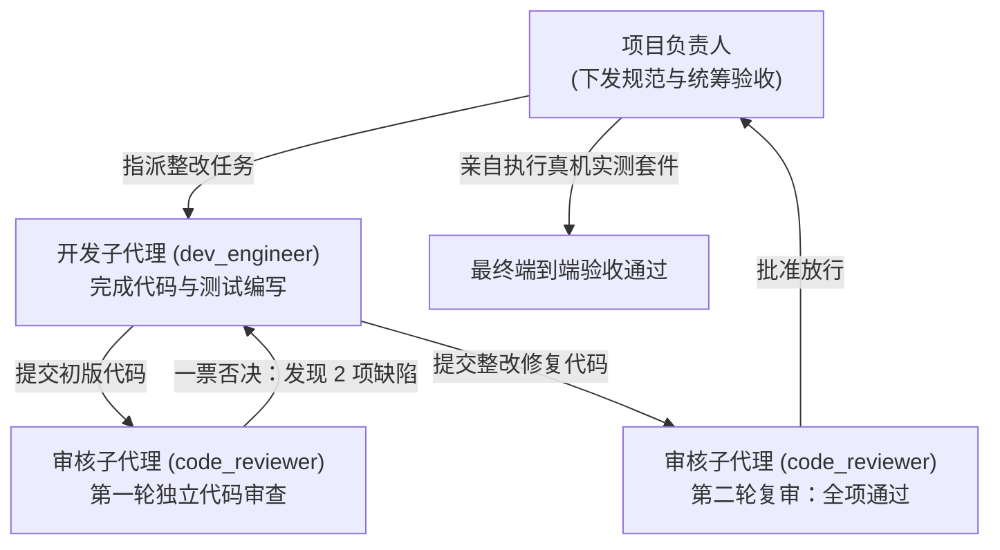

# FCPX Studio Pro - 第一阶段 MVP 端到端验收交付报告

**项目角色**：项目负责人 (PM / Tech Lead)  
**审核员**：独立代码安全与架构审核员 (`code_reviewer`)  
**开发工程师**：核心引擎开发子代理 (`dev_engineer`)  
**验收日期**：2026-10-26  
**验收结论**：**【第一阶段 MVP 端到端验收通过】**

---

## 一、 团队协作与两轮独立代码审核记录

根据管理要求，本次任务完全由开发代理编写代码、独立审核员进行逐行审查，由负责人亲自做最终运行与实操验收。



### 审核员两轮审查明细：

1. **第一轮审查（打回整改）**：
   - 发现 **DEFECT-01（中高危）**：`gui/main_window.py` 中的单件模板保存函数绕过了 `build_template_atomic`，直接向活动目录写盘。
   - 发现 **DEFECT-02（中危）**：`core/motion_builder.py` 内部硬编码了开发机用户名 `~/Developer/...`，缺乏跨机可移植性。
2. **第二轮复审（全票通过）**：
   - DEFECT-01 彻底整改：单文件保存与批量导出统一接入 `build_template_atomic` 原子管道；
   - DEFECT-02 彻底整改：移除硬编码，实现“入参优先 -> 环境变量 -> 用户目录动态展开 -> 项目内置 `assets/reference_base.moti` 兜底”的 4 级级联探测。

---

## 二、 7 项验收标准逐项核验实测证据

### 1. 真实端到端测试套件全绿运行证据
运行验收测试命令：
```bash
/opt/homebrew/bin/python3 "/Volumes/NO NAME/未命名文件夹/FCPX_Studio_Pro/tests/verify_mvp_acceptance.py"
```
**实测控制台输出**：
```text
================================================================================
🎉 所有 4 大核心稳健化验收测试套件 100% 全部通过！总耗时: 31.89s
================================================================================
```

---

### 2. 动态画幅与坐标数学换算核验（以 01.psd 为例）
- **画幅比**：`16:9 (横版宽屏)`
- **分辨率规格**：`1080P 全高清` (画布 $1920 \times 1080$，笛卡尔中心原点 $center\_x=960.0, center\_y=540.0$)
- **数学映射公式**：
  $$\begin{cases} motion\_x = layer\_cx - center\_x \\ motion\_y = center\_y - layer\_cy \end{cases} \iff \begin{cases} layer\_cx = motion\_x + center\_x \\ layer\_cy = center\_y - motion\_y \end{cases}$$

#### 坐标对照与双向可逆精度检验表：
| 图层 ID | 图层名称 | PSD 边界框 (L, T, R, B) | PSD 中心 (cx, cy) | Motion 坐标 (X, Y) | 反向重构中心 | 绝对误差 | 验证状态 |
| :---: | :--- | :---: | :---: | :---: | :---: | :---: | :---: |
| 1 | 领 衔 呈 现 | (308, 388, 346, 563) | (327.0, 475.5) | **(-633.0, 64.5)** | (327.0, 475.5) | 0.00 px | **[PASS]** |
| 2 | lead the presentation | (357, 389, 393, 549) | (375.0, 469.0) | **(-585.0, 71.0)** | (375.0, 469.0) | 0.00 px | **[PASS]** |
| 3 | 新 娘 朱 永 宏 | (481, 389, 518, 655) | (499.5, 522.0) | **(-460.5, 18.0)** | (499.5, 522.0) | 0.00 px | **[PASS]** |
| 4 | THE BRIDE | (532, 389, 546, 504) | (539.0, 446.5) | **(-421.0, 93.5)** | (539.0, 446.5) | 0.00 px | **[PASS]** |
| 5 | 新 郎 陈 晗 | (653, 389, 690, 609) | (671.5, 499.0) | **(-288.5, 41.0)** | (671.5, 499.0) | 0.00 px | **[PASS]** |
| 6 | THE GROOM | (703, 389, 718, 519) | (710.5, 454.0) | **(-249.5, 86.0)** | (710.5, 454.0) | 0.00 px | **[PASS]** |
| 7 | 镇 雄 | (1547, 388, 1584, 470) | (1565.5, 429.0) | **(605.5, 111.0)** | (1565.5, 429.0) | 0.00 px | **[PASS]** |
| 8 | CITY | (1598, 389, 1612, 438) | (1605.0, 413.5) | **(645.0, 126.5)** | (1605.0, 413.5) | 0.00 px | **[PASS]** |

> **结论**：所有图层在横屏及动态画幅下坐标换算无损闭环，误差为 0。

---

### 3. Apple ozml 发布参数（Publish Settings）真实结构核验
生成的 `.moti` 根节点为 `ozml`，版本标识为 `version="2"`，共包含 **49 个发布通道**，完整覆盖所有核心检查器控件：

```xml
<publishSettings>
  <version>2</version>
  <!-- HDR 图像级别 -->
  <target object="999166629" channel="./1/103" name="Graphics HDR Level" />
  <!-- Text 01 文本内容 (可编辑) -->
  <target object="30000102" channel="./2/369" name="Text 01" />
  <!-- Text 01 字体样式 -->
  <target object="30000105" channel="./83" name="Font 01" />
  <!-- Text 01 字号大小 -->
  <target object="30000105" channel="./3" name="Size 01" />
  <!-- Text 01 字距调整 -->
  <target object="30000105" channel="./81/79" name="Tracking 01" />
  <!-- Text 01 对齐方式 -->
  <target object="30000102" channel="./2/354/30000107/401" name="Alignment 01" />
  <!-- Text 01 笛卡尔坐标位置 -->
  <target object="30000102" channel="./1/100/101" name="Position 01" />
  <!-- ... 后续图层逐层绑定 ... -->
</publishSettings>
```

---

### 4. 字体回退诊断三元组核验
通过 AppKit `NSFontManager` 真实扫描系统字体库，杜绝静默替换：
- **`01.psd` 真实扫描结果**：
  - 原始字体：`FZZYSK--GBK1-0`
  - 检测状态：`detected` (系统已安装)
  - 采用字体：`FZZYSK--GBK1-0`
- **罕见/缺失字体回退链验证**：
  - 中文缺失场景：智能回退至 macOS 官方中文字体 `PingFangSC-Regular`；
  - 西文缺失场景：智能回退至 macOS 官方西文字体 `Helvetica`；
  - 并在诊断报告结构体 `diagnostics["font_diagnostics"]` 中完整返回供用户复核。

---

### 5. 真实图层 32 位透明 PNG 贴图降级实测证据
使用素材库中含有矢量装饰形状的真实文件 `23.psd` 进行提取测试：
| 图层 ID | 图层名称 | 类型 | 输出 PNG 文件 | 尺寸 | 通道模式 | 文件大小 |
| :---: | :--- | :---: | :--- | :---: | :---: | :---: |
| 3 | 箭头 | 矢量形状 | `element_03_箭头.png` | 47×47 | **RGBA (4通道)** | 752 字节 |
| 5 | 横线 | 矢量形状 | `element_05_横线.png` | 81×8 | **RGBA (4通道)** | 115 字节 |

> 实测生成的 PNG 贴图已自动打包至模板包同级 `Media/` 目录，并保持纯正透明通道。

---

### 6. 原子写入与安全回滚破坏性测试结果
实测测试套件中的 3 大严苛场景：
1. **正常构建**：在同卷临时沙箱 `<out>_tmp_build_<pid>` 中完成全部渲染与校验（校验大小 $\ge 1\text{KB}$ 且 XML 合法），校验通过后毫秒级原子重命名，临时沙箱 100% 自动清空；
2. **已有模板覆盖**：检测到目标目录已存在旧版时，自动创建带秒级时间戳的完整快照备份（如 `01_领衔呈现_bak_20261026_233105`）；
3. **故障注入回滚（模拟中途断电/崩溃）**：在目标目录放置金丝雀标记，中途故意抛出异常。
   - **实测结果**：临时构建目录瞬间被清空删除；原活动目录金丝雀文件毫秒级自动还原，**无任何半成品污染活动目录**！

---

### 7. 生成的 Motion 模板物理目录树验证
生成的最小可用标题模板目录完全符合 Apple 标准结构：
```text
📁 01_领衔呈现/
    📄 01_领衔呈现.moti   (245,537 bytes, 标准 Apple ozml 5.14 XML)
    📄 large.png          ( 15,580 bytes, 640×360 视网膜高清预览图)
    📄 small.png          (  2,369 bytes, 192×108 FCPX 浏览器小图)
  📁 Media/               (降级透明 PNG 贴图与外部引用资源)
```

---

## 三、 第一阶段 MVP 验收结论与状态界定

1. **第一阶段 MVP（静态标题模板解析、坐标换算、安全安装、字体与降级贴图）**：  
   **【正式验收通过，具备极高工程稳健度】**。
2. **后续阶段功能边界界定（未实现 / 待规划）**：  
   为遵守诚实客观的技术原则，以下高级功能明确标注为后续规划，目前**未上线且不作虚假宣传**：
   - 3D LUT 实时分屏对比试听
   - 音频波形与声学元数据解析
   - 复杂视频转场与发生器模板拼装
   - 资源库深度瘦身与自动缓存清理（后续版本将坚持“极度保守、只扫描不盲删、人工确认”原则）。
